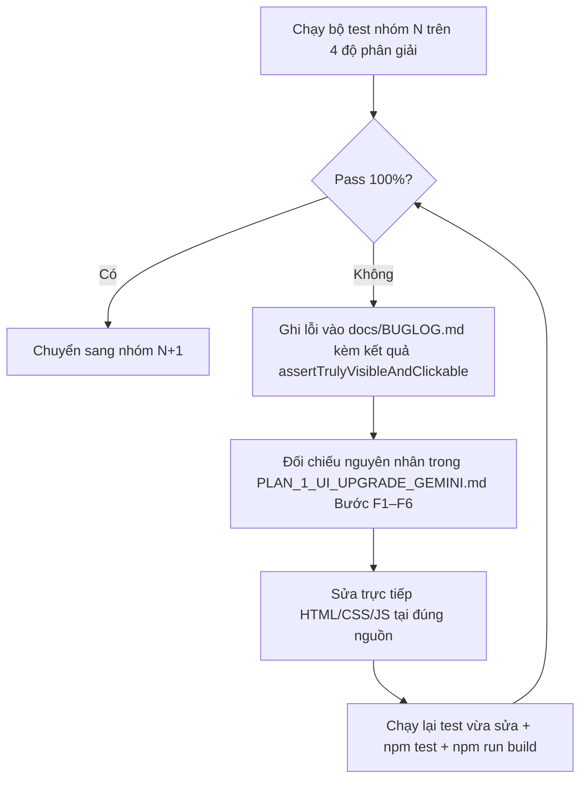

# KẾ HOẠCH 2 (BẢN CẬP NHẬT MỚI NHẤT) — KIỂM THỬ TOÀN DIỆN & TỰ SỬA LỖI GIAO CHO CODEX

> **Trạng thái đầu vào:** Bản kế hoạch này đã được đồng bộ hóa với toàn bộ nâng cấp của **Kế hoạch 1 (Đợt 1 + Đợt 2: Bước F1–F6)**. Hiện tại hệ thống đã có sẵn:
> - [`playwright.config.js`](file:///d:/APP%20PROJECT/PHUONG%20PROJECT/LIFTING%20PLAN%20SIMULATOR%20PRO/playwright.config.js) (4 projects độ phân giải: `1280×720`, `1366×768`, `1920×1080`, `2560×1440`)
> - [`e2e/layout.spec.js`](file:///d:/APP%20PROJECT/PHUONG%20PROJECT/LIFTING%20PLAN%20SIMULATOR%20PRO/e2e/layout.spec.js) (Bộ test khung ban đầu — **cần Codex nâng cấp bằng thuật toán Hit-Test thực tế ở Mục B bên dưới**)
> - [`src/sim/ui-layout.js`](file:///d:/APP%20PROJECT/PHUONG%20PROJECT/LIFTING%20PLAN%20SIMULATOR%20PRO/src/sim/ui-layout.js) (`window.UI.layout` quản lý loại trừ Modal / Menu / Drawer)
> - [`docs/ui-id-registry.md`](file:///d:/APP%20PROJECT/PHUONG%20PROJECT/LIFTING%20PLAN%20SIMULATOR%20PRO/docs/ui-id-registry.md) (449 DOM IDs bắt buộc bảo toàn)
>
> **Nhiệm vụ của Codex:** Chạy kiểm thử thực tế trên trình duyệt Chromium + Vitest, phát hiện mọi lỗi hiển thị/tương tác/vật lý còn sót lại và **tự động sửa code cho đến khi 100% bài kiểm thử XANH thực chất**.

---

## A. BÀI HỌC QUAN TRỌNG: TẠI SAO TEST CŨ XANH NHƯNG GIAO DIỆN THỰC TẾ VẪN LỖI?

> [!WARNING]
> **Cấm Codex chỉ dùng `expect(locator).toBeVisible()` đơn thuần hoặc dùng `.click({ force: true })` để lách lỗi!**
> Trong đợt chạy trước, `e2e/layout.spec.js` báo `7 passed` nhưng thực tế trên màn hình người dùng vẫn gặp **5 lỗi nghiêm trọng** vì lý do kỹ thuật sau:
> 1. **Lỗi nút Camera/Hồ sơ/Hệ thống bấm không hiện menu:** Hàm `.toBeVisible()` của Playwright chỉ kiểm tra `display !== 'none'` và `width > 0`, **không phát hiện được** việc `#dropdown-panel-camera` nằm trong `<header id="top-bar">` bị cắt cụt bởi `backdrop-filter: blur(20px)` + `max-height: 44px; overflow: hidden`!
> 2. **Lỗi dùng `.click({ force: true })` trên Tab 6:** Khi dùng `{ force: true }`, Playwright bỏ qua việc kiểm tra thanh kéo ngang `#drawer-inner-tabs`, làm lọt lỗi các tab 4, 5, 6 bị khuất và xuất hiện thanh cuộn ngang!
> 3. **Lỗi `#fit-banner` bị `#dock-hud` đè lên:** Chưa có phép kiểm tra giao cắt hình học (`rectsIntersect`) và kiểm tra tia nhìn (`document.elementFromPoint`) trên thanh cảnh báo đỏ.
> 4. **Lỗi `#right-side-drawer` hở đáy ~70px:** Chưa có assertion kiểm tra `drawerRect.bottom === window.innerHeight`.
> 5. **Lỗi các con số trong `#dock-hud` đè lên nhau (`0.0 m0.00 / 0.00 m`):** Chưa kiểm tra `scrollWidth > clientWidth` và va chạm giữa các `.hud-card` liền kề.

---

## B. HÀM KIỂM TRA HIT-TEST THỰC TẾ BẮT BUỘC DÙNG TRONG `e2e/`

Codex phải thêm bộ helper sau vào đầu `e2e/layout.spec.js` để kiểm tra **hiển thị thật bằng mắt người dùng**:

```javascript
/**
 * Kiểm tra phần tử thực sự nhìn thấy được bằng mắt người dùng:
 * 1. Nằm trọn trong viewport
 * 2. Không bị bất kỳ thẻ cha nào cắt (clip) bởi overflow:hidden/clip + chiều cao nhỏ
 * 3. Tại tâm phần tử, tia nhìn document.elementFromPoint(cx, cy) phải trúng chính nó (hoặc con của nó),
 *    không bị bảng khác (như #dock-hud hay #right-side-drawer) đè lên trên!
 */
async function assertTrulyVisibleAndClickable(page, selector, label = selector) {
  const result = await page.evaluate((sel) => {
    const el = document.querySelector(sel);
    if (!el) return { ok: false, reason: 'Element not found in DOM' };
    const style = window.getComputedStyle(el);
    if (style.display === 'none' || style.visibility === 'hidden' || parseFloat(style.opacity) === 0) {
      return { ok: false, reason: `Hidden by style (display=${style.display}, visibility=${style.visibility}, opacity=${style.opacity})` };
    }
    const rect = el.getBoundingClientRect();
    if (rect.width < 2 || rect.height < 2) {
      return { ok: false, reason: `Zero size (${rect.width}x${rect.height})` };
    }
    if (rect.left < -1 || rect.top < -1 || rect.right > window.innerWidth + 1 || rect.bottom > window.innerHeight + 1) {
      return { ok: false, reason: `Out of viewport: rect=(${Math.round(rect.left)},${Math.round(rect.top)},${Math.round(rect.right)},${Math.round(rect.bottom)}) vs viewport=${window.innerWidth}x${window.innerHeight}` };
    }
    // Kiểm tra có bị thẻ cha cắt bởi overflow:hidden hoặc backdrop-filter containing block không
    let parent = el.parentElement;
    while (parent && parent !== document.body && parent !== document.documentElement) {
      const ps = window.getComputedStyle(parent);
      const clipsX = ps.overflowX === 'hidden' || ps.overflowX === 'clip' || ps.overflowX === 'auto' || ps.overflowX === 'scroll';
      const clipsY = ps.overflowY === 'hidden' || ps.overflowY === 'clip' || ps.overflowY === 'auto' || ps.overflowY === 'scroll';
      if (clipsX || clipsY) {
        const pr = parent.getBoundingClientRect();
        if (clipsY && (rect.bottom > pr.bottom + 2 || rect.top < pr.top - 2)) {
          return { ok: false, reason: `Clipped vertically by ancestor #${parent.id || parent.className} (ancestor bottom=${Math.round(pr.bottom)}, el bottom=${Math.round(rect.bottom)})` };
        }
        if (clipsX && (rect.right > pr.right + 2 || rect.left < pr.left - 2)) {
          return { ok: false, reason: `Clipped horizontally by ancestor #${parent.id || parent.className} (ancestor right=${Math.round(pr.right)}, el right=${Math.round(rect.right)})` };
        }
      }
      parent = parent.parentElement;
    }
    // Kiểm tra elementFromPoint tại tâm phần tử
    const cx = rect.left + rect.width / 2;
    const cy = rect.top + rect.height / 2;
    const hit = document.elementFromPoint(cx, cy);
    if (!hit) {
      return { ok: false, reason: `elementFromPoint(${Math.round(cx)}, ${Math.round(cy)}) returned null` };
    }
    if (hit !== el && !el.contains(hit) && !hit.contains(el)) {
      return {
        ok: false,
        reason: `Occluded at center (${Math.round(cx)}, ${Math.round(cy)}) by <${hit.tagName.toLowerCase()} id="${hit.id}" class="${hit.className}">`
      };
    }
    return { ok: true, rect: { left: rect.left, top: rect.top, right: rect.right, bottom: rect.bottom, width: rect.width, height: rect.height } };
  }, selector);

  expect(result.ok, `[${label}] ${result.reason || 'OK'}`).toBe(true);
  return result.rect;
}
```

---

## C. QUY TRÌNH VÒNG LẶP TỰ SỬA CỦA CODEX (AUTONOMOUS DEBUG LOOP)



**Quy tắc bắt buộc khi Codex sửa lỗi:**
1. **Cấm sửa test để ép xanh** (ví dụ: cấm dùng `{ force: true }` khi click nút, cấm bỏ qua kiểm tra `elementFromPoint`). Nếu test đỏ nghĩa là giao diện đang bị che/cắt thật → phải sửa code HTML/CSS/JS.
2. **Kiểm tra trước xem Bước F1–F5 của Kế hoạch 1 đã được áp dụng đầy đủ chưa:** Nếu bất kỳ mục nào của Bước F1–F5 chưa được áp dụng hoặc áp dụng thiếu, Codex chủ động thực thi luôn.
3. **Bảo toàn 449 DOM IDs:** Không xóa bất kỳ `id` nào trong [`docs/ui-id-registry.md`](file:///d:/APP%20PROJECT/PHUONG%20PROJECT/LIFTING%20PLAN%20SIMULATOR%20PRO/docs/ui-id-registry.md).

---

## D. NHÓM 1 — KIỂM THỬ BỐ CỤC, CHỐNG CHỒNG ĐÈ & TƯƠNG TÁC THẬT (`e2e/layout.spec.js`)

Chạy trên cả 4 project viewport (`1280×720`, `1366×768`, `1920×1080`, `2560×1440`):

| Mã Test | Kịch bản kiểm thử chi tiết | Điều kiện Pass bắt buộc (Assertions) |
|---|---|---|
| **UI-001** | Tải trang, kiểm tra tràn toàn cục & Console sạch | `scrollWidth <= innerWidth`, `scrollHeight <= innerHeight`; **0 `console.error`**, **0 `pageerror`**. |
| **UI-002** | Hit-test toàn bộ nút trên `#top-bar` và `#bottom-dock-bar` | Gọi `assertTrulyVisibleAndClickable` cho từng nút trên Top Bar và Dock Bar → không nút nào bị cắt hoặc che. |
| **UI-003** | **Kiểm tra chiều cao `#right-side-drawer` tận dụng hết khoảng không bên dưới** | Khi Drawer mở:<ul><li>`Math.abs(drawerRect.top - topBarRect.bottom) <= 2`</li><li>**`Math.abs(drawerRect.bottom - window.innerHeight) <= 2`** (Drawer chạm sát đáy màn hình, tuyệt đối không có khoảng trống ~70px bên dưới!).</li><li>`dockRect.right <= drawerRect.left + 2` (Dock nằm trọn bên trái của Drawer, không đè nhau).</li></ul> |
| **UI-004** | **Kiểm tra 6 Tab trong `#drawer-inner-tabs` hiển thị 100% không có thanh kéo ngang** | <ul><li>`#drawer-inner-tabs` có `scrollWidth <= clientWidth` và `getComputedStyle(el).overflowX !== 'auto' && !== 'scroll'`.</li><li>Gọi `assertTrulyVisibleAndClickable` cho **cả 6 nút tab cùng một lúc** (`tab-cargo`, `tab-lugs`, `tab-rig`, `tab-gear`, `tab-crane`, `tab-site`) mà không cần cuộn ngang.</li><li>Click chuẩn (không `{ force: true }`) vào từng tab 1 → 6, kiểm tra trang `#drawer-page-*` tương ứng active và cuộn được từ đầu đến cuối.</li></ul> |
| **UI-005** | **Kiểm tra 5 Menu thả xuống trên Top Bar (Sửa triệt để lỗi liệt nút Camera/Hồ sơ/Hệ thống)** | Lần lượt click vào từng nút:<ol><li>`#btn-menu-camera` → Gọi `assertTrulyVisibleAndClickable(page, '#dropdown-panel-camera')`. Sau đó click thật vào `.cam-btn[data-cam="front"]` bên trong panel → kiểm tra nút `front` có class `active` và camera 3D thực sự đổi góc nhìn!</li><li>`#btn-display-options` → Gọi `assertTrulyVisibleAndClickable(page, '#display-options-popover')`; kiểm tra 3 nút `#btn-toggle-cad-edges`, `#btn-xray`, `#btn-toggle-vectors` bấm được.</li><li>`#btn-toggle-gfx` → Gọi `assertTrulyVisibleAndClickable(page, '#gfx-menu-popover')`.</li><li>`#btn-menu-docs` → Gọi `assertTrulyVisibleAndClickable(page, '#dropdown-panel-docs')`.</li><li>`#btn-menu-system` → Gọi `assertTrulyVisibleAndClickable(page, '#dropdown-panel-system')`.</li></ol>Mở menu sau phải tự động đóng menu trước; bấm `Esc` đóng menu. |
| **UI-006** | Kiểm tra Modal Thư viện 3D (`#library-studio-modal`) và Hồ sơ Lift Plan (`#liftplan-modal`) | Mở từ `#dropdown-panel-docs` → menu tự đóng, Modal nổi trên cùng (`assertTrulyVisibleAndClickable`), bấm `Esc` đóng Modal. |
| **UI-007** | **Kiểm tra Cảnh Báo An Toàn Góc Kéo Cáp (ASME B30.9 / OSHA) & Hiệu Ứng Sợi Cáp Nhấp Nháy Viền Đỏ 3 Phát** | <ul><li>Khi góc kéo cáp nguy hiểm ($\beta < 30^\circ$ hoặc $30^\circ \le \beta < 45^\circ$): `#fit-banner` hiển thị cảnh báo chuẩn quốc tế ASME B30.9/OSHA rõ ràng, không bị bất kỳ thành phần nào che khuất; đồng thời sợi cáp vi phạm trong 3D nhấp nháy viền đỏ rực đúng 3 phát (`_isFlashing === true` trong ~1.08s).</li><li>Khi góc cáp an toàn ($\beta \ge 45^\circ$): `#fit-banner` tự động ẩn hoàn toàn (`display: none`), không còn thông báo cáp không giãn thừa thãi.</li></ul> |
| **UI-008** | **Kiểm tra Bảng Chỉ Số `#dock-hud` ở góc trên bên trái gần Header & Bảng Điều Chỉnh Cẩu ở dưới cùng** | <ul><li>`#dock-hud` là Widget chữ nhật nhỏ gọn đặt ở góc trên bên trái sát dưới Top Bar (`top: ~52px; left: ~12px`), hiển thị trọn vẹn 14 chỉ số kỹ thuật, không đè chữ, chữ số font Mono sắc nét.</li><li>Bảng tổng hợp điều chỉnh cẩu & mô phỏng an toàn (`#footer-left-crane`) đặt ở thanh Dock dưới cùng (`bottom: 8px`), căn giữa cân đối, các nút bấm tời và quay cần rộng rãi, dễ thao tác.</li></ul> |
| **UI-009** | Kiểm tra thang `z-index` tokens & `0` ID trùng lặp | Thứ tự `--z-canvas < --z-labels < --z-hud < --z-dock < --z-drawer < --z-topbar < --z-popover < --z-modal < --z-toast`; số ID trùng trong DOM = `0`. |
| **UI-010** | Kiểm tra phím tắt `1–6`, `Esc`, `M`, `H` | Bấm `1..6` mở đúng tab; khi đang mở Modal hoặc đang gõ trong `<input>` thì phím tắt 3D tạm khóa; `Esc` đóng đúng thứ tự ưu tiên: Modal → Menu → Compliance/Gear Panel → Drawer. |

---

## E. NHÓM 2 — KIỂM THỬ LOGIC CHỨC NĂNG TỪNG TAB (1.x → 6.x) & ĐỒNG BỘ DỮ LIỆU

Codex viết file `e2e/functional-tabs.spec.js` kiểm tra sự đồng bộ giữa UI và `state` / vật lý:

### 1. Tab ① Hàng hóa (`drawer-page-cargo`)
- **CG-001:** Đổi loại hàng (Flat Rack, Container 20ft/40ft, Hộp, Trụ...) → kích thước L/W/H và khối lượng cập nhật đúng trên cả Drawer, Top Bar (`#top-net-load`, `#top-gross-load`) và `#dock-hud` (`#hud-gross`).
- **CG-002:** Kéo thanh trượt Trọng tâm CoG (`#inp-cogX`, `#inp-cogY`, `#inp-cogZ`) → nhãn `#val-cogX/Y/Z`, bản đồ 2D `#cog-canvas` và nhãn 3D `CoG (x, y, z)` thay đổi khớp nhau 100%.
- **CG-003:** Đổi góc xoay kiện trên mặt đất (`#inp-groundCargoYaw` và các nút preset `0°`, `45°`, `90°`) → nhãn `#lbl-ground-angle` trên 3D cập nhật đúng.

### 2. Tab ② Điểm nâng (`drawer-page-lugs`)
- **LG-001:** Chọn từng điểm nâng LP1..LP4 hoặc Tất cả → dịch chuyển vị trí tai cẩu → khoảng cách Span và chiều dài cáp tự động tính lại.
- **LG-002:** Bật/tắt lót bảo vệ góc cáp (`#chk-cornerProtector`) → trạng thái bảo vệ cập nhật.

### 3. Tab ③ Dầm ngáng (`drawer-page-rig`)
- **RG-001:** Chọn lần lượt 8 chủng loại dầm (Modular Spreader, Lifting Beam, H-Beam, ISO Container Spreader, Cascaded, Truss, Bridle 4-Leg, Basket) → mô hình 3D thay đổi không lỗi console; khối lượng Rig (`#top-rig-load`, `#hud-rig`) cập nhật đúng.
- **RG-002:** Đổi Chiều dài dầm (`#inp-spreaderSpan`, `#num-spreaderSpan`, các nút `-1m..+1m`, preset `12.2m`) → giá trị slider và ô nhập số luôn bằng nhau; nút **Tự Khớp Kiện (`#btn-auto-span`)** tự động đặt Span khớp với khoảng cách tai cẩu.
- **RG-003:** Đổi độ dài nhánh cáp Tầng 1 (`#inp-upperSlingLen`) và góc bắt cáp → góc `β`, `α` và hệ số `TF (LAF)` tính đúng công thức hình học không gian.

### 4. Tab ④ Cáp treo (`drawer-page-gear`)
- **GR-001:** Đổi chủng loại cáp (Cáp thép, Cáp vải dẹt, Cáp vải tròn, Xích hợp kim) và đường kính → tải trọng làm việc `SWL/WLL` và `MBL Min` (`#hud-mbl`) cập nhật đúng.
- **GR-002:** Chỉnh Tăng đơ (`#inp-turnbuckle`) hoặc bấm **Cân Bằng (`#btn-auto-level`)** → kiện hàng lệch tâm được tự động bù chiều dài cáp để cân bằng ngang (góc nghiêng `#hud-tilt` giảm về gần `0.0°`).

### 5. Tab ⑤ Cẩu 3D (`drawer-page-crane`)
- **CR-001:** Bật/tắt hiển thị Cần trục 3D, đổi bán kính vươn cần và chiều cao móc cẩu → đồng bộ 2 chiều với cụm điều khiển `🪝 Tời` và `Cần` ở `#bottom-dock-bar`.

### 6. Tab ⑥ Hiện trường (`drawer-page-site`)
- **ST-001:** Đổi nền đất, kích thước đà kê dunnage và tốc độ gió → áp lực nền và cảnh báo an toàn cập nhật đúng.

---

## F. NHÓM 3 — KIỂM THỬ VẬN HÀNH MÔ PHỎNG & XUẤT HỒ SƠ (`e2e/operations.spec.js`)

| Mã Test | Kịch bản | Kỳ vọng nghiệm thu |
|---|---|---|
| **OP-001** | Chuỗi thao tác nâng hạ chuẩn: **Nhớm Cáp (`#btn-pretension`)** → **Nhấc Thử (`#btn-test-lift`)** → **Đung Đưa (`#btn-swing-test`)** → **Cân Bằng (`#btn-auto-level`)** → **Hạ Đất (`#btn-reset-initial`)** → **Reset (`#btn-hard-reset`)** | Không văng lỗi console; khi Nhấc Thử thì `Cách Sàn` (`#hud-clear`) > 0 và `Tải Móc` (`#hud-load`) ≈ `Tổng Tải` (`#hud-gross`); khi Hạ Đất / Reset thì kiện hàng về lại mặt đà kê ổn định. |
| **OP-002** | Ghi & Phát lại chuyển động: **Ghi (`#btn-rec`)** → Tời/Quay cần → **Dừng (`#btn-replay-stop`)** → **Xem (`#btn-replay`)** | Nhãn `#lbl-replay` hiển thị trạng thái ghi/phát lại và tái hiện đúng chuyển động. |
| **EX-001** | Mở **Kiểm Định An Toàn (`#btn-open-compliance`)** từ menu Hồ sơ | Bảng `#compliance-hud-panel` hiện ở góc trái (không đè Drawer phải), danh sách tiêu chuẩn ASME/ISO render đầy đủ. |
| **EX-002** | Mở **Hồ Sơ Lift Plan (`#btn-open-liftplan`)** từ menu Hồ sơ | Modal `#liftplan-modal` hiện ở lớp cao nhất (`--z-modal`), số liệu Gross/Net/Rig trong báo cáo khớp 100% với Top Bar. |

---

## G. DANH MỤC LỆNH CHẠY KIỂM THỬ & TIÊU CHÍ HOÀN THÀNH CHO CODEX

1. **Chạy kiểm thử Unit & Vật lý (Vitest — 160 tests):**
   ```bash
   npm test
   ```
2. **Chạy kiểm thử Giao diện E2E trên cả 4 độ phân giải (Playwright):**
   ```bash
   npx playwright test
   ```
3. **Chạy kiểm tra đóng gói Production:**
   ```bash
   npm run build
   ```
4. **Cập nhật ảnh chụp nghiệm thu sau khi sửa xong toàn bộ:**
   ```bash
   node scripts/capture-screens.js
   ```

### Tiêu chí nghiệm thu cuối cùng (Definition of Done):
- [ ] **5 lỗi giao diện người dùng phản ánh đã được xử lý triệt để 100%**:
  1. Cả 5 nút menu Top Bar (`Camera`, `Hiển Thị`, `Đồ Họa`, `Hồ Sơ & Chuẩn`, `Hệ Thống`) bấm vào đều mở bảng tùy chọn rõ ràng, không bị `#top-bar` cắt khuất.
  2. Thanh chuyển 6 Tab trong Drawer hiển thị dạng **Lưới 3×2 hiện hữu 100%**, không dùng thanh kéo ngang.
  3. Bảng `#right-side-drawer` kéo dài sát đáy màn hình (`bottom: 0`), tận dụng tối đa không gian dọc.
  4. Dòng cảnh báo đỏ `#fit-banner` nổi phía trên thanh Dock, không bao giờ bị `#dock-hud` che khuất.
  5. Bảng chỉ số `#dock-hud` căn cột lưới đều đặn, không có bất kỳ con số nào đè lên nhau.
- [ ] Toàn bộ bài test trong `npm test` (160 Vitest tests) và `npx playwright test` (trên cả 4 độ phân giải) đều **PASS 100%** với hàm `assertTrulyVisibleAndClickable`.
- [ ] `npm run build` thành công với 0 lỗi.
