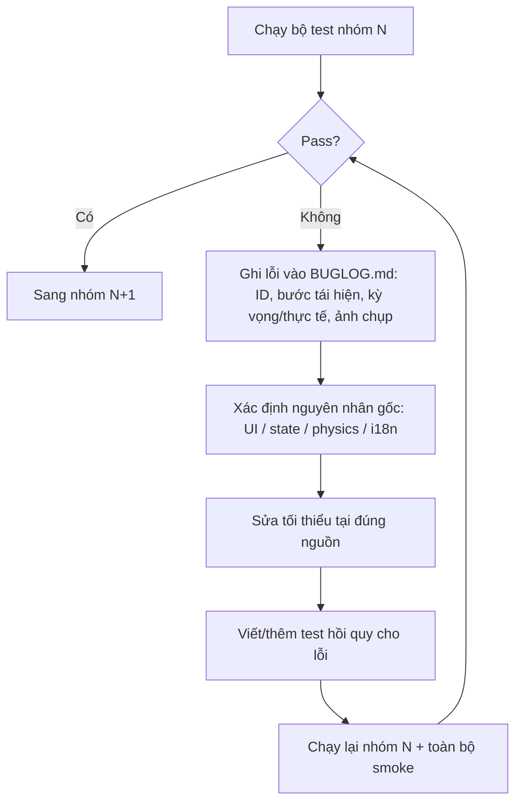

# KẾ HOẠCH 2 — KIỂM THỬ & TỰ SỬA LỖI (giao cho Codex)

> **Điều kiện đầu vào:** Kế hoạch 1 đã hoàn tất (hoặc từng bước đã merge). Codex đọc kèm `docs/ui-id-registry.md` và danh sách `data-testid` (Plan 1 §4).
> **Mục tiêu:** chứng minh mọi chức năng vận hành đúng, đồng bộ, không chồng đè; tự sửa đến khi **toàn bộ test xanh**.

---

## A. QUY TRÌNH VÒNG LẶP TỰ SỬA (bắt buộc)

**Quy tắc:**
1. Mỗi lỗi → 1 commit: `fix(BUG-xxx): mô tả` + test hồi quy đi kèm.
2. **Tối đa 5 vòng/lỗi.** Quá 5 vòng → dừng, ghi `BLOCKED` trong `BUGLOG.md` kèm giả thuyết, chuyển lỗi khác.
3. Không sửa test cho "xanh" khi lỗi thật còn đó; chỉ sửa test khi spec sai (ghi lý do).
4. Không phá hành vi chức năng cũ: sau mỗi sửa chạy `npm test` + `npm run build`.
5. Không đổi `id` DOM tuỳ tiện (xem registry). Không thêm phụ thuộc ngoài danh sách §B.
6. Kết thúc mỗi nhóm: cập nhật bảng **Tiến độ** (§J).

## B. HẠ TẦNG TEST (Bước 0)

| Công cụ | Việc | Lệnh |
|---|---|---|
| Vitest (đã có, 16 file trong `test/`) | Logic lõi/vật lý | `npm test` |
| **Playwright** (thêm devDependency) | Test UI thật trên `npm run dev` | `npm i -D @playwright/test; npx playwright install chromium` |
| Config | `playwright.config.js`: `webServer: { command:'npm run dev', url:'http://localhost:5173', reuseExistingServer:true }`; projects theo viewport §C | |
| Script mới trong `package.json` | `"test:ui":"playwright test"`, `"test:all":"vitest run && playwright test"` | |
| Hook console | Fixture fail test nếu có `console.error`, `pageerror`, request 404 | |
| Screenshot | `expect(page).toHaveScreenshot()` cho từng viewport (baseline sau Plan 1) | |

> Lưu ý: dev server có thể chạy cổng 5174 nếu 5173 bận → đọc cổng từ log hoặc đặt `server.strictPort` khi chạy test.

Viewport ma trận (lặp **mọi** test UI): `1280×720`, `1366×768`, `1536×864`, `1920×1080`, `2560×1440`.

---

## C. NHÓM 1 — LAYOUT, CHỒNG ĐÈ, KHÔNG BỊ CHE (Playwright)

Kiểm tra bằng `getBoundingClientRect` + `document.elementFromPoint` (không chỉ screenshot).

| ID | Kịch bản | Kỳ vọng |
|---|---|---|
| UI-001 | Tải trang, drawer đóng | Không scroll ngang/dọc `document`; mọi nút top bar/dock nằm trong viewport |
| UI-002 | Với **mỗi** nút top bar & dock: tâm nút → `elementFromPoint` | Trả về chính nút (không bị phần tử khác che) |
| UI-003 | Mở drawer (mỗi tab ①–⑥) | Drawer không giao (intersect) với dock/top bar; HUD cảnh báo vẫn nhìn thấy đủ |
| UI-004 | Duyệt toàn bộ ô nhập/slider trong drawer (cuộn từng mục) | Cuộn được tới cuối, không phần tử bị cắt chiều ngang (`scrollWidth ≤ clientWidth`) |
| UI-005 | Mở lần lượt: menu Camera → Hiển thị → Đồ họa → Hồ sơ → Hệ thống | Chỉ 1 menu mở; panel nằm trọn trong viewport |
| UI-006 | Mở modal Thư viện 3D / Lift Plan khi drawer mở | Modal ở lớp trên cùng (`elementFromPoint` giữa modal = modal); `Esc` đóng |
| UI-007 | Mở Analysis panel + drawer + menu cùng lúc | Không 2 panel nào giao nhau (trừ modal/menu overlay hợp lệ) |
| UI-008 | Kéo/phóng to/thu gọn Analysis panel | Luôn ở trong viewport, không đè dock |
| UI-009 | Thang z-index: lấy `getComputedStyle().zIndex` của 9 lớp | Thứ tự đúng `canvas<labels<hud<dock<drawer<topbar<popover<modal<toast`; không giá trị ngoài token |
| UI-010 | Đếm `id` trùng trong DOM | = 0 |
| UI-011 | Quét nút trùng chức năng (cùng handler/nhãn) | Không có 2 điều khiển trực tiếp cùng thông số (xem §F) |
| UI-012 | Resize động 2560→1280 khi đang mở drawer | Layout tự co, không vỡ, không phần tử mất |
| UI-013 | Đổi ngôn ngữ VI↔EN | Không nhãn bị tràn/cắt; không ký tự `?`/`�` hỏng dấu |
| UI-014 | Phím tắt `1–6`, `Esc`, `Tab` | Chuyển tab/đóng lớp đúng; focus không rơi vào phần tử ẩn |

**Tiêu chí qua nhóm:** 14/14 × 5 viewport xanh, screenshot khớp baseline (ngưỡng 0.2%).

---

## D. NHÓM 2 — CHỨC NĂNG TỪNG TAB (Playwright + đọc state qua `page.evaluate`)

Với mỗi thông số: đổi giá trị → kiểm tra (a) nhãn hiển thị, (b) state nội bộ, (c) cảnh vật 3D/số liệu top bar đổi, (d) giá trị ngoài miền bị chặn.

### D1. Tab ① Hàng hóa
| ID | Thao tác | Kỳ vọng |
|---|---|---|
| CG-001 | Chọn từng loại hàng (container, kiện, OOG…) | Khối hàng 3D đổi; Net load top-bar cập nhật |
| CG-002 | Nhập L/W/H, khối lượng (biên: 0, âm, 1e6, rỗng, chữ) | Từ chối giá trị sai, hiện thông báo; không NaN trong HUD |
| CG-003 | Công thức thể tích/khối lượng riêng | `m = ρ·V` khớp ±0.5% |
| CG-004 | Dời CoG (X,Y,Z) | Chấm CoG 3D dịch chuyển; góc nghiêng khi nhấc đổi đúng chiều; nằm trong hộp hàng |
| CG-005 | Yaw: ô số, nút ±5°, preset 0/45/90 | Hàng xoay; **chỉ 1 điều khiển** (không còn bản ở dock); giá trị giữ khi đổi tab |
| CG-006 | Bật OOG | Panel OOG hiện; thông số OOG ảnh hưởng CoG/kiểm định |

### D2. Tab ② Điểm nâng
| ID | Thao tác | Kỳ vọng |
|---|---|---|
| LG-001 | Thêm/xoá/đổi loại pad-eye | Tai cẩu 3D đúng vị trí; số nhánh cáp = số điểm |
| LG-002 | Kéo điểm ra ngoài thân hàng | Cảnh báo; bị chặn/snap về biên |
| LG-003 | Bật corner protector | Hiện mô hình bảo vệ; hệ số ma sát/hư hại đổi |
| LG-004 | Đối xứng theo CoG | Lệch CoG → điểm nâng đề xuất cân bằng |

### D3. Tab ③ Dầm & Hình học treo
| ID | Thao tác | Kỳ vọng |
|---|---|---|
| RG-001 | Chọn 8 loại dầm (Modular, Lifting Beam, H-Beam, ISO, Cascaded, Truss, Bridle 4-leg, Basket) | Mô hình 3D đổi, tải trọng bản thân dầm vào Rig load |
| RG-002 | Span: slider, ô số, nút −1m…+1m, preset 6/8/10/12.2/14 | Hai nguồn (slider/ô số) luôn bằng nhau; preset nhảy đúng |
| RG-003 | Góc bridle: 30°…70° preset 45/60/70 | Lực nhánh `T = W/(n·sinθ)` sai số <1%; cảnh báo khi θ<45° |
| RG-004 | Chiều dài nhánh cáp tầng 1/2 | Hình học 3D & góc tự tính lại, hiển thị "thiếu x m" đúng |
| RG-005 | Cảnh báo "thiếu 0.16 m – cáp trên …" | Hiện đủ chữ (không cắt) và biến mất khi sửa đúng |

### D4. Tab ④ Cáp & Phụ kiện
| ID | Thao tác | Kỳ vọng |
|---|---|---|
| GR-001 | Đổi loại/đường kính sling, shackle | WLL, hệ số an toàn cập nhật; so với catalog (`RiggingEquipmentCatalog.js`) |
| GR-002 | Tải vượt WLL | Thanh tải đỏ, trạng thái "NGUY HIỂM", Nhấc thử bị chặn/cảnh báo |
| GR-003 | Phân bổ lực (T0–T3) khi CoG lệch | Tổng T·cosα = W; tổng không vượt 1% |
| GR-004 | Bảng khối lượng (Net/Rig/Gross) | `Gross = Net + Rig` = số top bar (3 nơi nhất quán) |
| GR-005 | Editor gear (cũ `#gear-editor`) | Chỉnh phụ kiện không mở panel nổi thứ 3 |

### D5. Tab ⑤ Cẩu & Móc
| ID | Thao tác | Kỳ vọng |
|---|---|---|
| CR-001 | Chọn cẩu 3D, bán kính | Biểu đồ tải LMI đổi; % sử dụng đúng so với `CraneLoadChartEngine` |
| CR-002 | Vượt tải định mức | Trạng thái cảnh báo, âm báo (nếu bật), khoá nâng |
| CR-003 | Độ cao hook: dock `num-hook-y` ↔ ô trong tab ⑤ | Hai nơi đồng bộ tức thì; phạm vi 0.5–32 m bị kẹp |
| CR-004 | Hoist ±0.2/±1 m, Kéo/Hạ giữ chuột, preset | Hook di chuyển đúng tốc độ; dừng khi nhả |
| CR-005 | Slew ±5°, ±15° | Cẩu quay; HUD góc cập nhật |

### D6. Tab ⑥ Hiện trường
| ID | Thao tác | Kỳ vọng |
|---|---|---|
| ST-001 | Nền đất/sàn thử, áp lực nền (kPa, T/m²) | Giá trị so `GroundPressureEngine` ±1% |
| ST-002 | Sàn kê (dunnage) đổi vật liệu/kích thước | Áp lực nền giảm theo diện tích; cảnh báo nếu vượt |
| ST-003 | Gió 0–12.8 m/s | Lực gió, góc lệch (0.24°…) cập nhật; ≥ngưỡng → cảnh báo |
| ST-004 | Độ dốc nền | Hàng/cẩu nghiêng đúng, kiểm định cập nhật |

---

## E. NHÓM 3 — VẬN HÀNH DOCK & MÔ PHỎNG (Playwright + Vitest)

| ID | Kịch bản | Kỳ vọng |
|---|---|---|
| OP-001 | **Nhóm cáp** (pretension) | Cáp căng, không trùng; trạng thái `sim-status-text` đổi |
| OP-002 | **Nhấc thử** | Hàng rời đất, tải phân bổ ổn định, không rung quá ngưỡng; trạng thái "ĐANG NHẤC" |
| OP-003 | **Đong đưa** | Con lắc dao động tắt dần, chu kỳ ≈ 2π√(L/g) ±5% |
| OP-004 | **Cân bằng** | Góc nghiêng ≤ 0.5° sau cân bằng; lực nhánh đều |
| OP-005 | **Hạ đất** | Hàng hạ êm, tiếp đất, tải về 0 |
| OP-006 | **Reset / Hard reset** | Hard reset đưa về mặc định (so snapshot state ban đầu); Reset giữ cấu hình |
| OP-007 | **Đặt mốc (baseline)** | Lưu và so sánh sai khác ở HUD |
| OP-008 | **Ghi → Dừng → Xem** | File replay sinh ra, phát lại khớp quỹ đạo ±1 frame |
| OP-009 | Bấm liên tiếp/nhanh nhiều nút | Không treo, không trạng thái kẹt (xem §H) |
| OP-010 | Lệnh bị khoá đúng ngữ cảnh | VD: "Hạ đất" khi chưa nhấc → vô hiệu/báo; không crash |

---

## F. NHÓM 4 — ĐỒNG BỘ STATE & KHÔNG TRÙNG LẶP

Bảng "nguồn chân lý": mỗi thông số có **1 state**, mọi widget hiển thị dùng chung.

| Thông số | Widget phải đồng bộ | Test |
|---|---|---|
| Hook height | `num-hook-y`, `inp-hook-y`, tab ⑤, HUD | SY-001: đổi ở 1 nơi → các nơi còn lại bằng nhau ≤ 1 frame |
| Cargo yaw | tab ① (ô số/preset), gizmo 3D, nhãn `lbl-ground-angle` | SY-002 |
| Span dầm | tab ③ slider/ô số/nút, mô hình 3D, Lift Plan | SY-003 |
| Net/Rig/Gross | Top bar, HUD, tab ④, PDF/Lift Plan | SY-004: 4 nơi cùng giá trị |
| Đơn vị (m/ft, T/kN) | Mọi nhãn & ô nhập | SY-005: đổi đơn vị không đổi giá trị vật lý (quy đổi 2 chiều round‑trip ±1e‑6) |
| Ngôn ngữ | Mọi nhãn + PDF | SY-006 |
| Lưu/khôi phục session | Reload trang | SY-007: state (hàng, dầm, cáp, cẩu, view) khôi phục đủ |
| Trùng lặp chức năng | Quét handler: không 2 nút gọi cùng hành động | SY-008 (script đọc `data-action`/id registry) |

Test hồi quy "đổi qua lại 20 lần, tab nào cũng đúng" cho mỗi cặp widget.

---

## G. NHÓM 5 — LÕI KỸ THUẬT & VẬT LÝ (Vitest — mở rộng `test/`)

Chạy trước (xanh) rồi **bổ sung** các test thiếu:

| ID | File gợi ý | Nội dung |
|---|---|---|
| EN-001 | `engineering.test.js` (có) + mới | Lực nhánh theo góc, hệ số động (DAF), WLL theo chuẩn ASME B30.9/B30.20 |
| EN-002 | `ground_pressure.test.js` (mới) | Áp lực nền với/không dunnage; biên 0 |
| EN-003 | `crane_load_chart.test.js` (mới) | Nội suy bảng tải, ngoài miền → từ chối |
| EN-004 | `liftplan.test.js` (có) + mới | Số liệu trong hồ sơ = state; checksum nhất quán |
| EN-005 | `cog_tilt_stability.test.js` (có) | Bổ sung CoG ngoài tâm đa giác điểm nâng |
| PH-001 | `rigging.test.js`, `simulation.test.js` (có) | Cáp chỉ chịu kéo (unilateral), không xuyên hàng |
| PH-002 | `solid_collision_and_settling.test.js` (có) | Hàng đặt xuống ổn định < 3 s, không xuyên đất |
| PH-003 | `physics_destruction.test.js` (có) | Cáp đứt khi vượt MBL, sự kiện phát đúng |
| PH-004 | Property‑based (fast-check, tuỳ chọn) | Ngẫu nhiên 1000 cấu hình hợp lệ → không NaN/Infinity, tổng lực cân bằng |
| PH-005 | Determinism | Cùng seed → cùng kết quả sau 600 bước |

Thêm kiểm tra: không `NaN`/`Infinity` trong **mọi** phần tử văn bản số (Playwright quét `textContent` toàn drawer/HUD).

---

## H. NHÓM 6 — ĐỘ BỀN, HIỆU NĂNG, LỖI BIÊN

| ID | Kịch bản | Kỳ vọng |
|---|---|---|
| RB-001 | Soak 10 phút đổi tham số ngẫu nhiên + thao tác dock | Không lỗi console; heap tăng < 20% (rò rỉ); FPS TB ≥ 30 |
| RB-002 | Spam click 200 lần/10 s mọi nút | Không treo, không trạng thái chồng |
| RB-003 | Đổi cấu hình ngay giữa lúc nhấc/đong đưa | Mô phỏng ổn định hoặc reset sạch |
| RB-004 | Nhập số cực đoan (1e9, −1, 0, NaN, rỗng, dấu phẩy) | Bị chặn, giá trị cũ giữ nguyên |
| RB-005 | Tải mô hình 3D lỗi/định dạng sai (Thư viện) | Thông báo lỗi thân thiện, app vẫn chạy |
| RB-006 | WebGL mất context | Thông báo + khôi phục |
| RB-007 | Hiệu năng khởi động | Load < 5 s (dev) , `npm run build` thành công, cảnh báo chunk có chủ đích |
| RB-008 | Màn hình cảm ứng/touch (Playwright `hasTouch`) | Tab, menu, slider dùng được |

---

## I. NHÓM 7 — XUẤT HỒ SƠ & TIÊU CHUẨN

| ID | Kịch bản | Kỳ vọng |
|---|---|---|
| EX-001 | Mở **Lift Plan** (`btn-open-liftplan`) | Modal đầy đủ, điền đúng từ state |
| EX-002 | **Xuất PDF nhanh** | File tải về > 0 KB; parse text: có tên dự án, Net/Rig/Gross, WLL, góc, kết luận An toàn |
| EX-003 | **Kiểm định** (`btn-open-compliance`) | Danh sách điều kiện khớp từng thông số hiện tại; đổi thông số → badge pass/fail đổi |
| EX-004 | Export OBJ/lưu session | Mở lại nhập được, so snapshot |
| EX-005 | Thư viện 3D: upload STL/GLB/ảnh | Mô hình xuất hiện, gắn được làm hàng; hủy không để rác trong scene |

---

## J. THEO DÕI TIẾN ĐỘ & BÁO CÁO

Tạo `docs/TEST_REPORT.md` cập nhật liên tục:

| Nhóm | Số test | Pass | Fail | Blocked | Ghi chú |
|---|---|---|---|---|---|
| C Layout | 14×5 | | | | |
| D Tab | 40+ | | | | |
| E Vận hành | 10 | | | | |
| F Đồng bộ | 8 | | | | |
| G Lõi/Vật lý | 10+ | | | | |
| H Độ bền | 8 | | | | |
| I Xuất hồ sơ | 5 | | | | |

`docs/BUGLOG.md` mỗi lỗi: `BUG-001 | mức (Blocker/Major/Minor) | nhóm | bước tái hiện | kỳ vọng vs thực tế | nguyên nhân | commit sửa | test hồi quy`.

## K. THỨ TỰ THỰC HIỆN CHO CODEX
1. §B hạ tầng → chạy `npm test` hiện có, sửa lỗi nền (baseline xanh).
2. §C Layout → §F Đồng bộ (vì ảnh hưởng mọi test sau).
3. §D từng tab → §E vận hành → §G lõi → §I xuất hồ sơ → §H độ bền.
4. Chạy lại **toàn bộ** `npm run test:all` ×3 lần liên tiếp (chống flaky).
5. Chụp screenshot cuối, cập nhật README, tạo tag `v-ui-stable`.

## L. TIÊU CHÍ HOÀN THÀNH (Definition of Done)
- [ ] `npm run test:all` xanh **3 lần liên tiếp**, 0 test bị skip không lý do.
- [ ] `npm run build` thành công; 0 `console.error`/`pageerror` trong mọi kịch bản.
- [ ] Mọi test layout xanh ở cả **5 viewport**; không phần tử bị che/chồng.
- [ ] 8 bảng đồng bộ (§F) xanh; 0 id trùng; 0 chức năng lặp.
- [ ] `BUGLOG.md` không còn Blocker/Major mở; Minor còn lại có kế hoạch.
- [ ] Hồ sơ PDF/Lift Plan số liệu khớp 100% với HUD & state.
