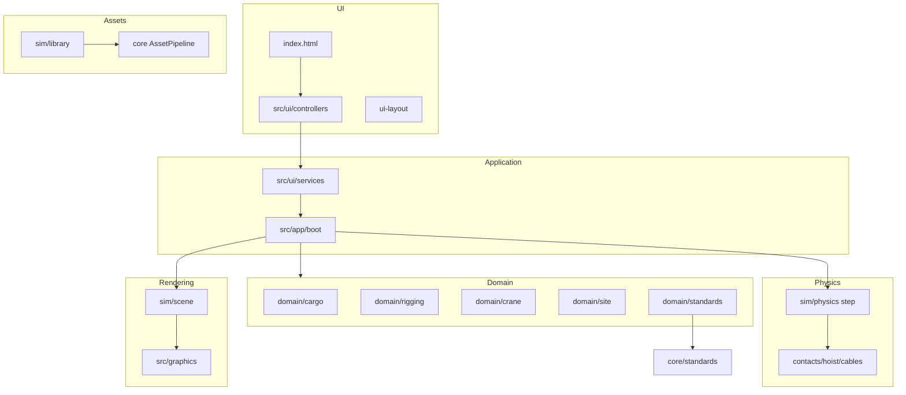

# Target architecture

## Layer rules

| Layer | May depend on |
|-------|----------------|
| UI controllers | app services, shared events |
| App | domain, physics ports, shared |
| Domain | shared only (pure) |
| Physics | domain types, shared |
| Rendering | shared, domain read-models |
| Assets | shared, graphics |

## Runtime object (post–Phase 1)

`createRuntime()` owns `state`, `phy`, scene handles, and an `events` bus. Modules export `install(runtime)` instead of relying on lexical concat.
